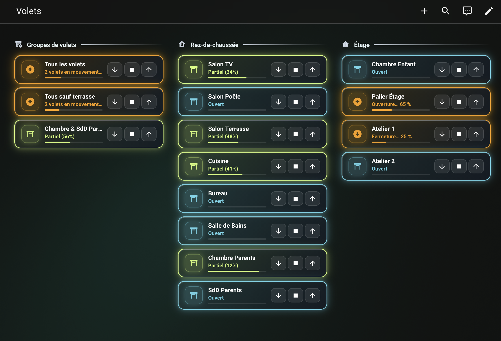
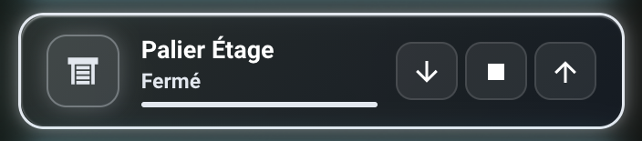
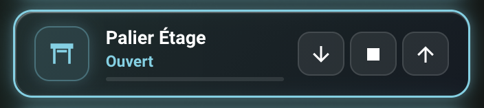
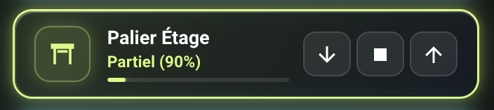
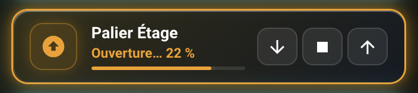
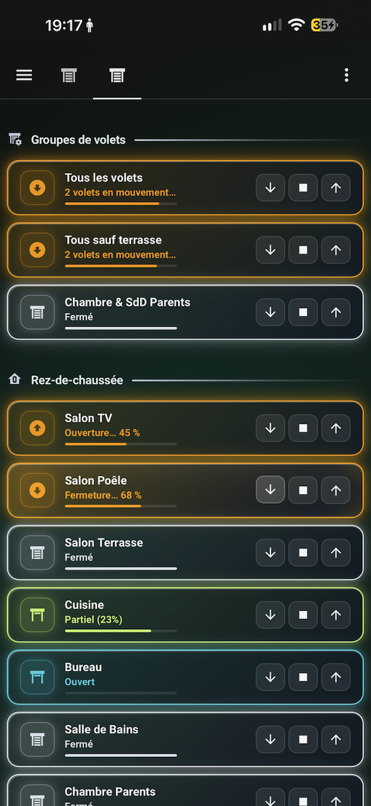
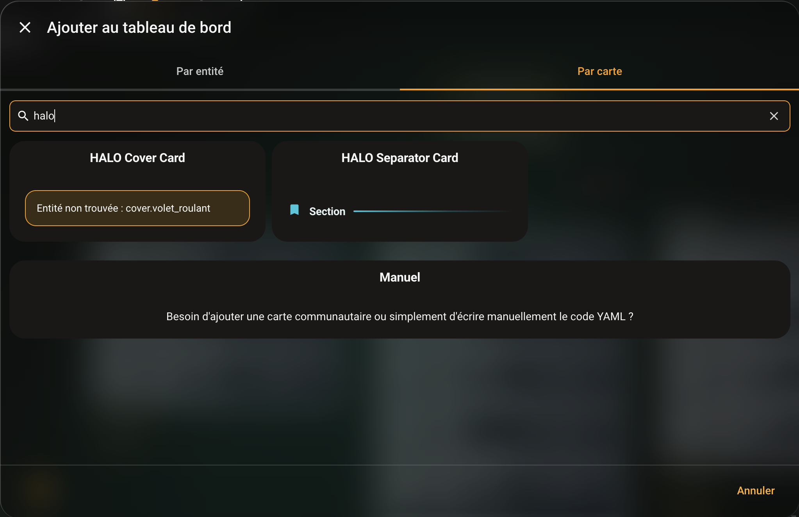
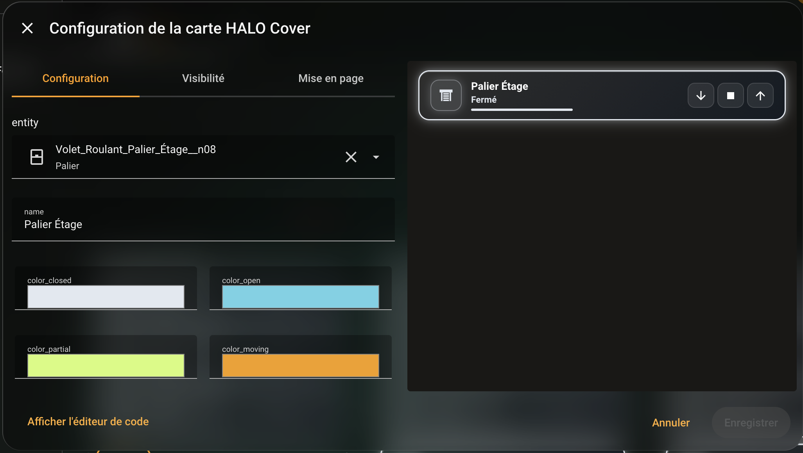
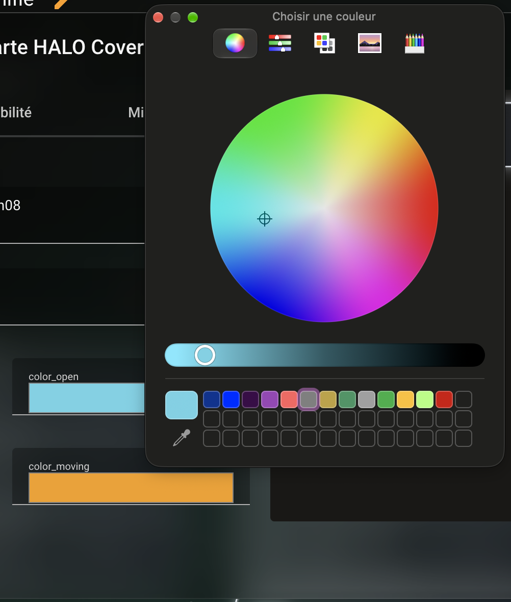
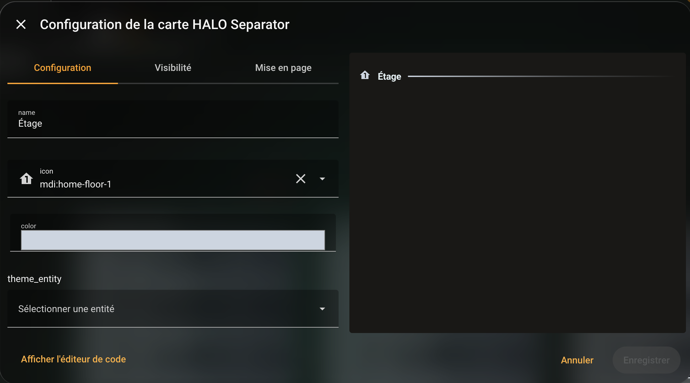

# 🌟 HALO Button Card

<p align="center">
  
</p>

<p align="center">
  <a href="https://github.com/hacs/default"></a>
  <a href="https://github.com/MilesTEG1/HALO-Button-Card/releases"></a>
  <a href="LICENSE"></a>
  
</p>

<p align="center">
  <b>English</b> | <a href="README.fr.md">Français 🇫🇷</a> | <a href="https://github.com/MilesTEG1/HALO-Button-Card/wiki">Wiki Documentation 📖</a>
</p>

---

## 💎 Overview

**HALO Button Card** is an open-source, turnkey Lovelace card collection for [Home Assistant](https://www.home-assistant.io/). Inspired by the **Liquid Glass / HOLM** visual design philosophy, it blends translucent glassmorphism with dynamic, state-reactive glowing **HALO** borders.

Unlike complex multi-template setups requiring 50+ lines of YAML per tile, HALO cards are **native Web Components** with complete **Visual UI Editor (`<ha-form>`)** support. No manual YAML is required, while power users retain full declarative flexibility.

---

## ✨ Key Features

- 🧊 **Liquid Glass Aesthetic**: Translucent frosted backdrop blur (`16px saturate(180%)`), deep obsidian gradients, and delicate specular borders.
- 🌈 **Ambient Glowing Halo**: Dynamic 3-stage colored glow that actively reflects device states.
- 🪟 **Smart Cover Control (`halo-cover-card`)**: Built-in NodOn/Zigbee asynchronous movement algorithm with accurate travel estimations and responsive micro-controls.
- 📑 **Neon Section Dividers (`halo-separator-card`)**: Sleek title and icon section divider with a continuous neon accent line.
- 🎨 **Full Visual No-YAML Editor**: Intuitive card configuration powered by Home Assistant's native `<ha-form>`, featuring entity pickers, MDI icon search, and a complete **2D RGB Color Wheel**.
- ⚡ **Zero-Flicker Persistent DOM**: High-performance architecture ensuring 100% click reliability and instantaneous touch response.
- 🧩 **Cascading Theme Engine**: Out-of-the-box operation with zero required helpers, plus optional synchronization with view or dashboard `input_select` entities.

---

## 🎨 Dynamic State Colors

Each card state is highlighted by an ambient glow, illustrated below using custom palette values:

| State | Status | Sample Color | Visual Preview |
| :--- | :--- | :---: | :---: |
| **Closed** | Position `0%` | `#e2e8f0` |  |
| **Open** | Position `100%` | `#6ad2e6` |  |
| **Partial** | Position `1% - 99%` | `#d4fb78` |  |
| **Moving** | Opening / Closing travel | `#f59e0b` |  |

---

## 📱 Mobile Experience & Responsive Layout

HALO cards are engineered from the ground up for high-density, touch-optimized interaction across smartphones, tablets, and wall-mounted dashboards:

<p align="center">
  
</p>

- **Calibrated Height (68px)**: Consistent tile footprint preventing layout shifts and flickering in Lovelace `sections` or `grid` views.
- **Finger-Friendly Micro-Controls**: Distinct touch zones for Down, Stop, and Up commands with instant tactile feedback.
- **Glassmorphic Contrast**: Readable white frosted typography and ambient halos that maintain high legibility even under direct ambient lighting.

---

## 📦 Installation

### Option 1: Via HACS (Recommended)

1. Open **HACS** in your Home Assistant instance.
2. Click the three dots menu (**⋮**) in the top right corner and choose **Custom repositories**.
3. Add the repository:
   - **Repository**: `https://github.com/MilesTEG1/HALO-Button-Card`
   - **Type**: `Dashboard`
4. Search for **HALO Button Card**, click **Download**, and confirm.
5. Reload your browser window (`Ctrl + F5` or `Cmd + Shift + R`).

### Option 2: Manual Installation

1. Download `dist/halo-button-card.js` from the [Latest Release](https://github.com/MilesTEG1/HALO-Button-Card/releases).
2. Copy `halo-button-card.js` into your Home Assistant directory: `<config>/www/halo-button-card.js`.
3. In Home Assistant, navigate to **Settings ➔ Dashboards ➔ Resources** (three dots top right).
4. Add a new resource:
   - **URL**: `/local/halo-button-card.js`
   - **Resource type**: `JavaScript Module`

---

## 🛠️ Card Usage & Examples

### 1. `custom:halo-cover-card`

Turnkey roller shutter tile with real-time status tracking, travel progress bar, and Down / Stop / Up action controls.

```yaml
type: custom:halo-cover-card
entity: cover.living_room_shutter
name: Living Room
color_closed: '#e2e8f0'
color_open: '#6ad2e6'
color_partial: '#d4fb78'
color_moving: '#f59e0b'
```

#### Supported Configuration Options:

| Field | Type | Default | Description |
| :--- | :---: | :---: | :--- |
| `entity` | `string` | **Required** | Target `cover` entity or `cover` group. |
| `name` | `string` | *friendly_name* | Custom card display label. |
| `color_closed` | `string` | `#FFB69C` | Halo & accent color when completely closed. |
| `color_open` | `string` | `#96E1FF` | Halo & accent color when completely open. |
| `color_partial`| `string` | `#38bdf8` | Halo & accent color at intermediate positions. |
| `color_moving` | `string` | `#f59e0b` | Halo & accent color while actively traveling. |

---

### 2. `custom:halo-separator-card`

Replaces complex custom template dividers with a sleek native Web Component.

```yaml
type: custom:halo-separator-card
name: Ground Floor
icon: mdi:home-floor-0
color: '#26c6da'
```

#### Supported Configuration Options:

| Field | Type | Default | Description |
| :--- | :---: | :---: | :--- |
| `name` | `string` | `Section` | Section title. |
| `icon` | `string` | `mdi:bookmark`| Section leading MDI icon. |
| `color` | `string` | `#26c6da` | Neon gradient accent color (Hex or HOLM palette name). |
| `theme_entity` | `string` | *auto* | Optional `input_select` entity driving view/dashboard colors. |

---

## 🖥️ Graphical UI Configuration (No YAML Needed)

Every card in the suite includes an integrated graphical editor built on Home Assistant's native `<ha-form>`. Power users can still write raw YAML, but visual configuration is 100% supported out of the box.

### 🔍 Interactive Card Discovery

HALO cards register with `window.customCards` for seamless discovery in the native Home Assistant card picker:

<p align="center">
  
</p>

### 🎛️ Visual Editors & Precision 2D Color Wheel

Configuring cards is completely visual—no need to memorize configuration keys or write hex codes manually:

<p align="center">
  
  &nbsp;
  
</p>

1. **Cover Card Editor (`halo-cover-card`)**: Select target `cover` entities or groups with automatic domain filtering, customize labels, and tune individual state colors.
2. **Precision 2D Color Wheel**: Tap any color swatch to launch Home Assistant's native 2D color picker with hue/saturation navigation, brightness slider, discrete RGB primary channels (0-255), and hexadecimal inputs.

### 📑 Section Divider Editor (`halo-separator-card`)

<p align="center">
  
</p>

- **Section Title**: Frosted typography heading.
- **Interactive Icon Picker**: Live Material Design Icons search (`mdi:...`).
- **Gradient Accent Color**: Dynamic neon line color selector.
- **Theme Binding**: Optional `input_select` dropdown selector to sync divider tones across dashboard views.

---

## 👥 Authors & Co-Engineering

This project is co-engineered through pair-programming between human architectural direction and autonomous AI agent execution:

- 👤 **Architect & Lead**: **Pierrick (MilesTEG1)** — Project vision, UI/UX HOLM styling, validation, and real-world hardware integration.
- 🤖 **Co-Engineer**: **IDA / Antigravity Agent (Google DeepMind)** — TypeScript Web Components architecture, persistent DOM performance engine, and NodOn Zigbee travel algorithms.

---

## 📄 License

This project is licensed under the **MIT License** — see the [LICENSE](LICENSE) file for details.
