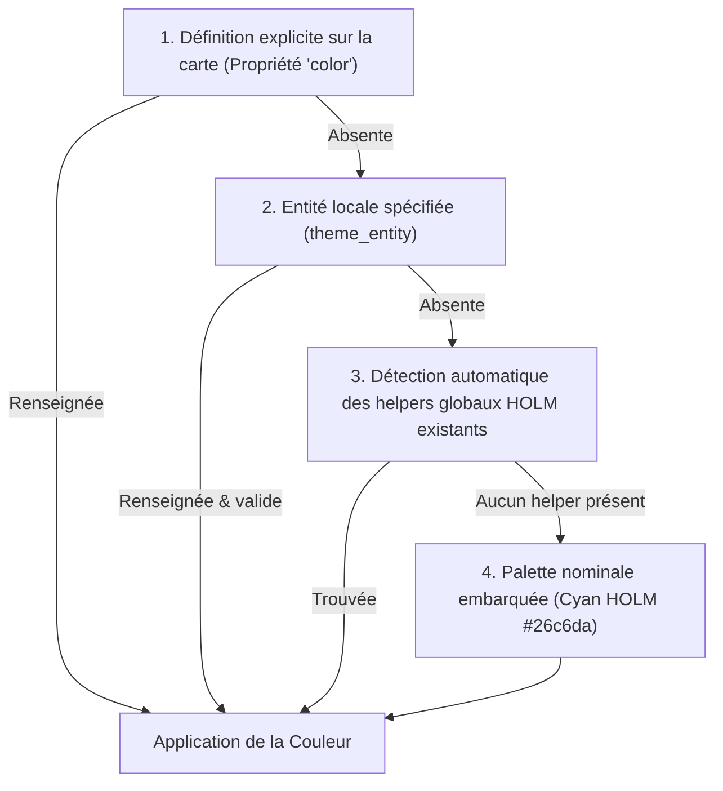

# 🌈 Moteur de Thèmes en Cascade (HACS Plug & Play)

## 1. Contrainte de Distribution HACS

Les intégrations de tableau de bord distribuées via HACS sont des plugins Frontend (JavaScript/CSS). Elles ne peuvent pas créer automatiquement d'entités côté serveur dans Home Assistant (pas de création magique d'`input_select` ou d'`input_text`).

Imposer à l'utilisateur de créer manuellement 5 ou 10 helpers préalables constitue un frein majeur à l'adoption.

---

## 2. Résolution en Cascade

La fonction `resolveThemeColor()` applique un ordre de priorité descendant :



### Palette HOLM Intégrée en Standard

La suite HALO embarque nativement les 16 nuances emblématiques de la charte graphique HOLM :

| Nom HOLM | Code Hex |
| :--- | :---: |
| **Cyan HOLM** | `#26c6da` |
| **Bleu Céleste** | `#38bdf8` |
| **Saphir Océan** | `#2f86ff` |
| **Menthe Givrée** | `#00e5a3` |
| **Émeraude** | `#10b981` |
| **Vert Lime** | `#84cc16` |
| **Jaune Soleil** | `#facc15` |
| **Ambre Doré** | `#f59e0b` |
| **Orange Flamme** | `#ff5a1f` |
| **Corail Pêche** | `#fb923c` |
| **Rose Rubis** | `#f43f5e` |
| **Rose Bonbon** | `#f472b6` |
| **Fuchsia Néon** | `#d946ef` |
| **Améthyste** | `#a855f7` |
| **Violet Nuit** | `#8b5cf6` |
| **Blanc Glace** | `#e2e8f0` |

---

## 3. Utilisation Avancée : Liaison Dynamique par Vue

Pour les utilisateurs souhaitant synchroniser la couleur de tous les séparateurs d'une vue avec un sélecteur :

```yaml
type: custom:halo-separator-card
name: Rez-de-chaussée
icon: mdi:home-floor-0
theme_entity: input_select.couleur_theme_ouvertures
```
La carte écoutera automatiquement les changements d'état de ce helper et appliquera la teinte correspondante en direct.
